<div align="center">

<h1>🌍 Boundless-World-Model </h1>

<p align="center">
    <a href="https://huggingface.co/spaces/WorldArena/WorldArena"></a>  
    <a href="https://huggingface.co/BLM-Lab/Boundless-World-Model"></a>
</p>

</div>

> **BWM** is a physically consistent, action-conditioned video world model built upon Wan2.2-TI2V-5B, serving as a low-cost yet high-fidelity simulator for robotic manipulation.

## 🗞️ News

- **[2026-05]** 🏆 **Top results on WorldArena Leaderboard!** BLM ranks 1st among open-source models on Track 1 and Track 2 Data Engine, while BWM-fast ranks 2nd overall on Track 1.
- **[2026-05]** 🚀 **Inference code released!** Generate action-conditioned robot manipulation videos with BWM. See [🛠️ Usage](#️-usage).
- **[2026-05]** 🎉 **Model definition released!** The BWM architecture and core model components are now available.

## 🏆 Competition Results

### **CVPR 2026 WorldArena Challenge**

- **BLM**: 🥇 **1st Place** among open-source models on **Track 1** and **Track 2 Data Engine**.
- **BWM-fast**: 🥈 **2nd Place** on the overall **Track 1** leaderboard.

<table align="center">
  <tr>
    <td align="center">
      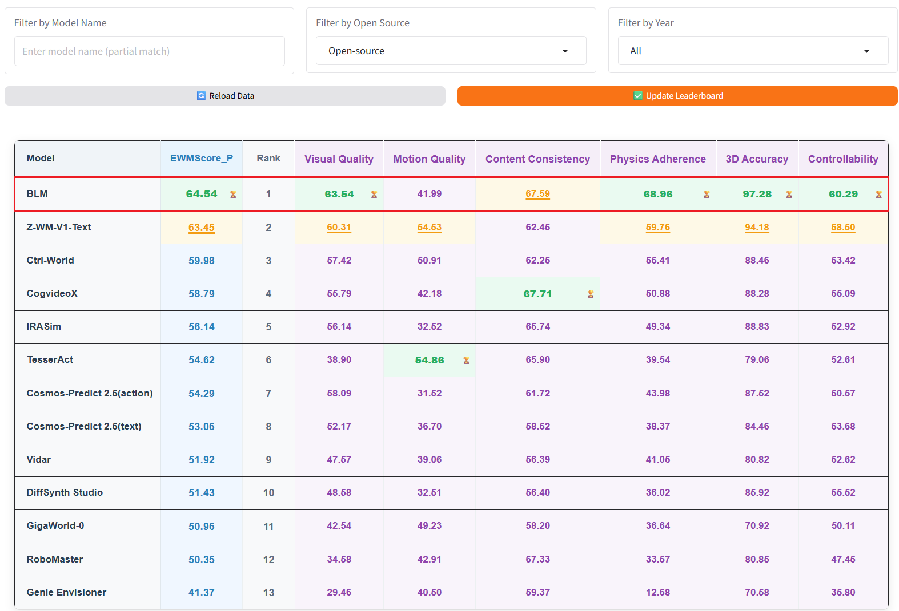<br>
      <sub>Track 1 open-source leaderboard</sub>
    </td>
  </tr>
  <tr>
    <td align="center">
      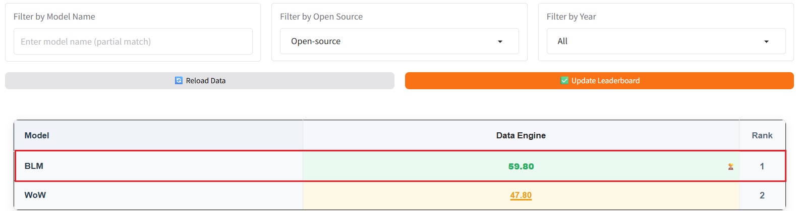<br>
      <sub>Track 2 Data Engine open-source leaderboard</sub>
    </td>
  </tr>
  <tr>
    <td align="center">
      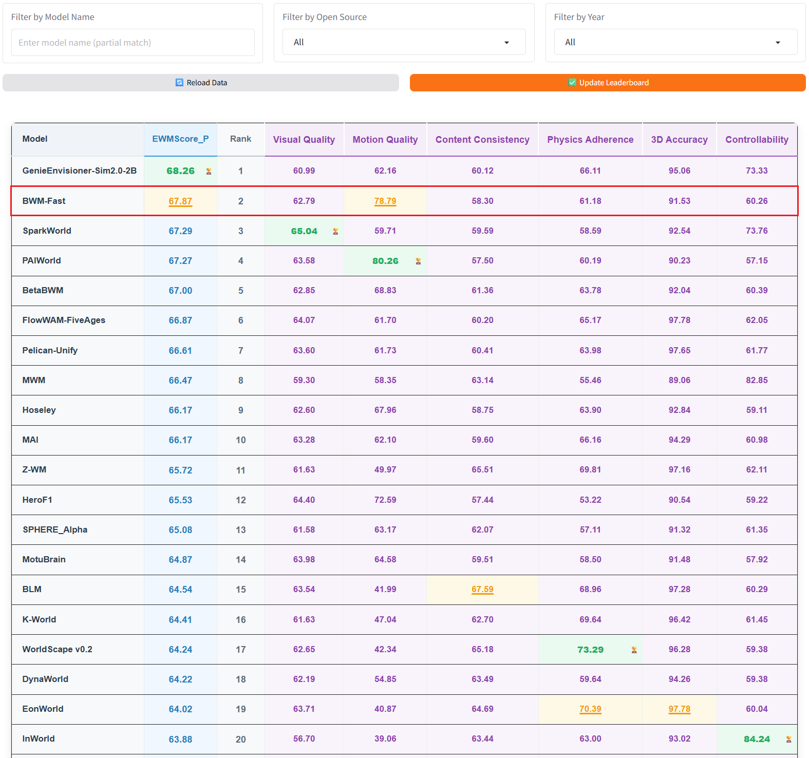<br>
      <sub>Track 1 overall leaderboard</sub>
    </td>
  </tr>
</table>

Leaderboard: https://huggingface.co/spaces/WorldArena/WorldArena

## Table of Contents
- [✅ TODO](#-todo)
- [🏗️ Framework](#️-framework)
- [🎬 Qualitative Results](#-qualitative-results)
- [🛠️ Usage](#️-usage)
- [🏋️ Training](#️-training)
- [🙏 Acknowledgements](#-acknowledgements)
- [📧 Contact](#-contact)
- [📜 Citing](#-Citing)

---

## ✅ TODO

- [x] Release inference code
- [x] Release model definition
- [x] Release model weights
- [ ] Release training code
- [ ] Release technical report

---

## 🏗️ Framework

Coming soon !

---

## 🎬 Qualitative Results

### **CVPR 2026 WorldArena Challenge**

> The following simulation scenes are generated autoregressively by **BWM** from initial frames and action sequences in the [**WorldArena test set**](https://github.com/tsinghua-fib-lab/WorldArena/), achieving high-fidelity visual realism while maintaining long-horizon physical consistency.

#### 🧩 Scene 1: Compositional Spatial Rearrangement

  <table align="center" >
    <tr>
      <td>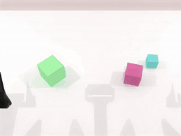</td>
      <td>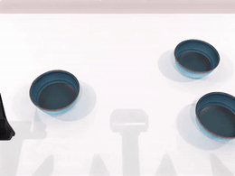</td>
    </tr>
  </table>

- **Task**: arrange blocks by size, stack bowls
- **Challenge**: Multi-object spatial ordering, stacking stability, and contact-rich placement
- **Ours**:
  - ✅ Preserves object identity and target layout
  - ✅ Maintains stable stacking contacts
  - ✅ Predicts adaptive gripper control

#### 🚪 Scene 2: Articulated Hinge Interaction

  <table align="center" >
    <tr>
      <td>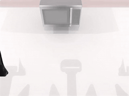</td>
      <td></td>
    </tr>
  </table>

- **Task**: open microwave, open laptop
- **Challenge**: Articulated hinge motion, constrained rotation, and persistent object state
- **Ours**:
  - ✅ Captures hinge-constrained opening dynamics
  - ✅ Maintains coherent object geometry during rotation
  - ✅ Preserves opened states over long-horizon rollouts

#### 🕹️ Scene 3: Fine-Grained Affordance Interaction

  <table align="center" >
    <tr>
      <td>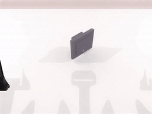</td>
      <td>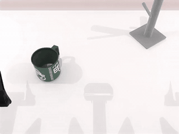</td>
    </tr>
    <tr>
      <td>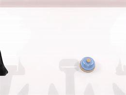</td>
      <td>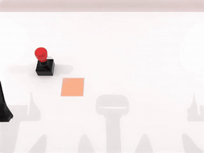</td>
    </tr>
  </table>

- **Task**: turn switch, hang mug, click bell, stamp seal
- **Challenge**: Small contact regions, constrained placement, and precise state-changing interactions
- **Ours**:
  - ✅ Captures fine-grained affordance dynamics
  - ✅ Aligns contact with object affordances
  - ✅ Preserves state-changing interactions

#### 🤝 Scene 4: Bimanual Coordination and Handover

  <table align="center" >
    <tr>
      <td>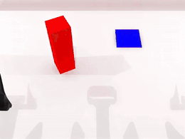</td>
      <td>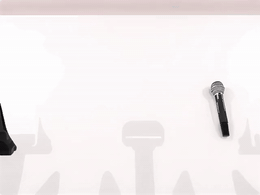</td>
    </tr>
  </table>

- **Task**: hand over block, hand over mic
- **Challenge**: Dual-arm synchronization, inter-arm occlusion, and coordinated grasp timing
- **Ours**:
  - ✅ Models synchronized dual-arm motion
  - ✅ Preserves object continuity
  - ✅ Avoids close-contact collisions

#### 📦 Scene 5: Long-Horizon Constrained Placement

  <table align="center" >
    <tr>
      <td>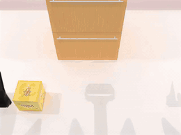</td>
      <td>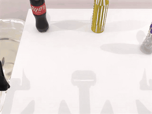</td>
    </tr>
  </table>

- **Task**: put object in cabinet, put bottles in dustbin
- **Challenge**: Long-horizon transport, partial occlusion, and constrained final placement
- **Ours**:
  - ✅ Maintains long-horizon scene coherence
  - ✅ Handles occlusion without object drift
  - ✅ Produces stable constrained placement

### **Out-of-Distribution Generalization**

> To test generalization beyond benchmark initial states, we use **GPT-Image-2-created initial scenes** with original robot action sequences and let **BWM** autoregressively roll out the future under object appearance shifts.

  <table align="center" >
    <tr>
      <td></td>
      <td></td>
      <td></td>
    </tr>
    <tr>
      <td></td>
      <td></td>
      <td></td>
    </tr>
  </table>

- **Task**: shake bottle, put object in cabinet
- **Challenge**: Novel initial scenes and object appearance shifts
- **Ours**:
  - ✅ Generalizes to GPT-Image-2-created initial scenes
  - ✅ Preserves action-conditioned dynamics
  - ✅ Maintains coherent robot-object interaction

---

## 🛠️ Usage

### Quick Start: Video Generation Inference

#### Environment Setup

```bash
# Create conda environment
conda create -n BWM python=3.10.20
conda activate BWM

# Install PyTorch with CUDA support
pip install torch==2.8.0 torchvision==0.23.0 torchaudio==2.8.0 --index-url https://download.pytorch.org/whl/cu128

# Install DiffSynth-Studio
pip install diffsynth==2.0.11

# Install dependencies
pip install -r requirements.txt
```

#### Model Weights

Download the [Wan2.2-TI2V-5B](https://www.modelscope.cn/models/Wan-AI/Wan2.2-TI2V-5B) base model from [ModelScope](https://www.modelscope.cn):

```bash
modelscope download --model Wan-AI/Wan2.2-TI2V-5B --local_dir models/Wan2.2-TI2V-5B
```

Download the [BWM checkpoint](https://huggingface.co/BLM-Lab/Boundless-World-Model) from [Hugging Face](https://huggingface.co):

```bash
hf download BLM-Lab/Boundless-World-Model step-12000.safetensors --local-dir ckpt/BLM
```

#### Run Inference

The demo metadata, videos, actions, and normalization statistics are already included under `demo/`.

Set local paths before running inference:

```bash
cp scripts/local.example.sh scripts/local.sh
```

Update `MODEL_PATHS` and `CKPT_PATH` in `scripts/local.sh`, then run:

```bash
bash scripts/infer_example.sh
```

## 🏋️ Training

Coming soon !

---

## 🙏 Acknowledgements

This project builds upon the following open-source projects and benchmarks.
We thank these teams for their contributions:

- Wan2.2: https://github.com/Wan-Video/Wan2.2
- DiffSynth-Studio: https://github.com/modelscope/DiffSynth-Studio
- WorldArena: https://github.com/tsinghua-fib-lab/WorldArena/
- ABot-PhysWorld: https://github.com/amap-cvlab/ABot-PhysWorld

We also acknowledge the following engineering contributions:

- Wentao Tan: basic architecture design · [Email](mailto:tan.wt.lucky@gmail.com) · [GitHub](https://github.com/FutureTwT)
- Zengrong Lin: core code implementation · [Email](mailto:zengronglin@tongji.edu.cn) · [GitHub](https://github.com/zzezze)
- Yang Sun: code refactoring and software maintainability · [Email](mailto:young7869264s@gmail.com) · [GitHub](https://github.com/DandelionWow)

We further thank all project contributors for their valuable discussions, support for the paper experiments, and participation in the WorldArena challenge.

- **Supervision**: Heng Tao Shen
- **Principal Investigator**: Lei Zhu
- **Student Project Leadership**: Wentao Tan, Tianshi Wang
- **WorldArena Challenge**:
  - **Strategy Design**: Wentao Tan, Bowen Wang
  - **Inference-Time Scaling**: Tianshi Wang, Chenming Li
  - **Data Pipeline**: Bowen Wang, Enci Xie, Wentao Tan, Chenming Li, Yang Sun, Yipeng Chen, Xuebin Fang, Zequn Wang
  - **Metric Analysis**: Wentao Tan, Enci Xie, Chenming Li, Tianshi Wang
  - **Closed-Loop Rollout**: Zequn Wang, Zhe Li, Heng Zhi, Zengrong Lin
- **Model Architecture**:
  - **Innovation**: Wentao Tan, Zengrong Lin, Enci Xie, Baixu Ji
  - **Model Training**: Zengrong Lin, Yang Sun, Zhe Li
- **Post Training**: Yang Sun, Zengrong Lin, Wentao Tan
- **Baselines**: Zequn Wang, Heng Zhi, Yipeng Chen, Chenyu Liu, Wenjie Yang, Hao Xue, Chen Xu
- **VLAs Support**:
  - **Real-World**: Heng Zhi
  - **Simulation**: Heng Zhi, Baixu Ji
- **Infrastructure**:
  - **Distributed Evaluation**: Wenhao Liu
  - **Real-World Setup**: Zhe Li
- **Discussion Support**: Fengling Li, Pengfei Zhang, Lanyun Zhu, Ying Cheng, Jingkuan Song, Xing Xu, Yunfan Ren, Qi Zhang

---

## 📧 Contact

Contributors are listed in alphabetical order by English name.

[Baixu Ji](mailto:baixuji@tongji.edu.cn), [Bowen Wang](mailto:wbw1090809192@gmail.com), [Chen Xu](mailto:1187092474@qq.com), [Chenming Li](mailto:2252661@tongji.edu.cn), [Chenyu Liu](mailto:2431993@tongji.edu.cn), [Enci Xie](mailto:elect@tongji.edu.cn), [Fengling Li](mailto:fenglingli2023@gmail.com), [Hao Xue](mailto:2534205@tongji.edu.cn), [Heng Tao Shen](mailto:shenhengtao@tongji.edu.cn), [Heng Zhi](mailto:2431992@tongji.edu.cn), [Jingkuan Song](mailto:jingkuan.song@gmail.com), [Lanyun Zhu](mailto:zhulanyun1999@gmail.com), [Lei Zhu](mailto:leizhu0608@gmail.com), [Pengfei Zhang](mailto:mima.zpf@gmail.com), [Qi Zhang](mailto:zhangqi_cs@tongji.edu.cn), [Tianshi Wang](mailto:tswang0116@163.com), [Wenhao Liu](mailto:liuwwhh594@gmail.com), [Wenjie Yang](mailto:blankyang@tongji.edu.cn), [Wentao Tan](mailto:tan.wt.lucky@gmail.com), [Xing Xu](mailto:interxuxing@hotmail.com), [Xuebin Fang](mailto:xuebinfang@163.com), [Yang Sun](mailto:young7869264s@gmail.com), [Ying Cheng](mailto:yingcheng@tongji.edu.cn), [Yipeng Chen](mailto:2431994@tongji.edu.cn), [Yunfan Ren](mailto:yunfan@tongji.edu.cn), [Zengrong Lin](mailto:zengronglin@tongji.edu.cn), [Zequn Wang](mailto:wangzequn369@gmail.com), [Zhe Li](mailto:zheli25@tongji.edu.cn)

---

## 📜 Citing

If you find **BWM** is useful in your research or applications, please consider giving us a **star** 🌟.

---


## Stage 2 训练加速

`scripts/train_stage2.sh bwm` 默认使用 `SHARD_GRAD_OP`、每个 update 同步一次梯度、fused AdamW 和 `expandable_segments`。每卡 batch 仍为 1，通过 `BWM_GRADIENT_ACCUMULATION_STEPS` 调整累积次数。双任务并跑时显存接近满载；测速需要让两组同时运行，不能用单任务速度代替。

可先按训练 metadata 的每个窗口预提取 VAE latent。完整视频和历史帧分别编码，扩散噪声及历史加噪仍在训练时采样。以下命令使用与默认入口相同的数据配置：

```bash
python -m accelerate.commands.launch --multi_gpu --num_processes 8 --mixed_precision bf16 \
  scripts/precompute_stage2_latents.py \
  --config configs/train/train_wan22_ti2v_5b_action_adaln.yaml \
  --model_paths "$MODEL_DIR" --dataset_base_path "$DATASET_DIR" \
  --dataset_metadata_path "$DATASET_DIR/metadata_train.jsonl" \
  --val_dataset_metadata_path "$DATASET_DIR/metadata_test.jsonl" \
  --action_stat_path "$DATASET_DIR/stat.json" \
  --vae_latent_cache_dir outputs/cache/stage2_vae_6tasks_81f_256x192
```

默认入口在上述目录的训练、验证缓存均完成时自动使用缓存；其他目录可通过 `BWM_VAE_LATENT_CACHE_DIR` 指定，设为空字符串可禁用。缓存会检查 metadata、视频文件、VAE 权重文件身份以及预处理参数，配置不符时拒绝使用。

可通过 `BWM_ACCELERATE_CONFIG=configs/stage2/accelerate_fsdp_multi_gpu.yaml BWM_FSDP_SYNC_EACH_BATCH=1 BWM_FUSED_ADAMW=0 BWM_VAE_LATENT_CACHE_DIR=""` 恢复原计算路径。已有完整 checkpoint 继续通过 `BWM_RESUME_FROM` 恢复；旧 AdamW 状态会保留，并切换为 fused 更新。
