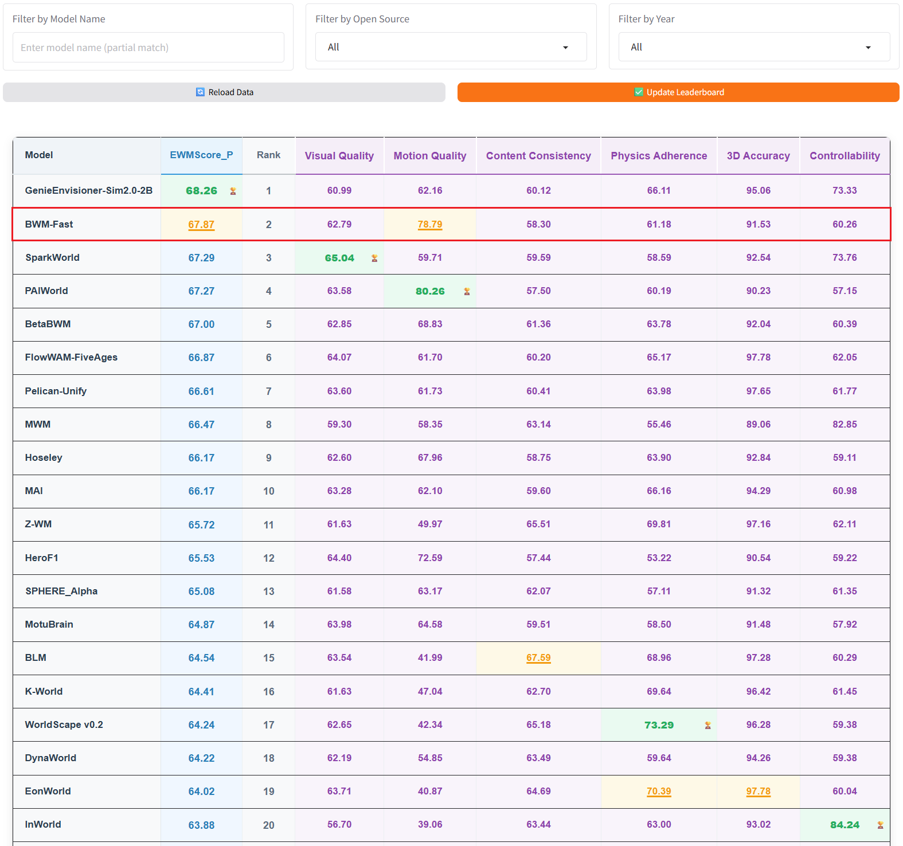
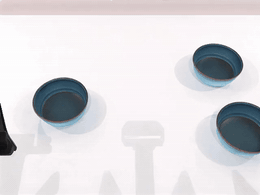
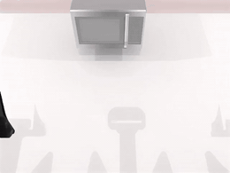
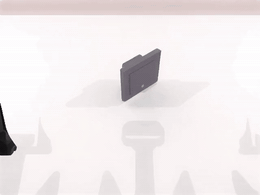
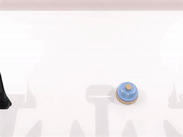
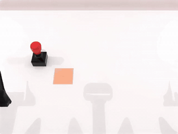
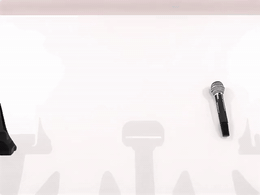
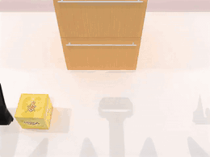
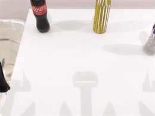

<div align="center">

<h1>🌍 Boundless-World-Model </h1>

<p align="center">
    <a href="https://huggingface.co/spaces/WorldArena/WorldArena"></a>  
    <a href="https://huggingface.co/BLM-Lab/Boundless-World-Model"></a>
</p>

</div>

> **BWM** is a physically consistent, action-conditioned video world model built upon Wan2.2-TI2V-5B, serving as a low-cost yet high-fidelity simulator for robotic manipulation.

## 🗞️ News

- **[2026-05]** 🏆 **Top results on WorldArena Leaderboard!** BLM ranks 1st among open-source models on Track 1 and Track 2 Data Engine, while BWM-fast ranks 2nd overall on Track 1.
- **[2026-05]** 🚀 **Inference code released!** Generate action-conditioned robot manipulation videos with BWM. See [🛠️ Usage](#️-usage).
- **[2026-05]** 🎉 **Model definition released!** The BWM architecture and core model components are now available.

## 🏆 Competition Results

### **CVPR 2026 WorldArena Challenge**

- **BLM**: 🥇 **1st Place** among open-source models on **Track 1** and **Track 2 Data Engine**.
- **BWM-fast**: 🥈 **2nd Place** on the overall **Track 1** leaderboard.

<table align="center">
  <tr>
    <td align="center">
      <br>
      <sub>Track 1 open-source leaderboard</sub>
    </td>
  </tr>
  <tr>
    <td align="center">
      <br>
      <sub>Track 2 Data Engine open-source leaderboard</sub>
    </td>
  </tr>
  <tr>
    <td align="center">
      <br>
      <sub>Track 1 overall leaderboard</sub>
    </td>
  </tr>
</table>

Leaderboard: https://huggingface.co/spaces/WorldArena/WorldArena

## Table of Contents
- [✅ TODO](#-todo)
- [🏗️ Framework](#️-framework)
- [🎬 Qualitative Results](#-qualitative-results)
- [🛠️ Usage](#️-usage)
- [🏋️ Training](#️-training)
- [🙏 Acknowledgements](#-acknowledgements)
- [📧 Contact](#-contact)
- [📜 Citing](#-Citing)

---

## ✅ TODO

- [x] Release inference code
- [x] Release model definition
- [x] Release model weights
- [ ] Release training code
- [ ] Release technical report

---

## 🏗️ Framework

Coming soon !

---

## 🎬 Qualitative Results

### **CVPR 2026 WorldArena Challenge**

> The following simulation scenes are generated autoregressively by **BWM** from initial frames and action sequences in the [**WorldArena test set**](https://github.com/tsinghua-fib-lab/WorldArena/), achieving high-fidelity visual realism while maintaining long-horizon physical consistency.

#### 🧩 Scene 1: Compositional Spatial Rearrangement

  <table align="center" >
    <tr>
      <td></td>
      <td></td>
    </tr>
  </table>

- **Task**: arrange blocks by size, stack bowls
- **Challenge**: Multi-object spatial ordering, stacking stability, and contact-rich placement
- **Ours**:
  - ✅ Preserves object identity and target layout
  - ✅ Maintains stable stacking contacts
  - ✅ Predicts adaptive gripper control

#### 🚪 Scene 2: Articulated Hinge Interaction

  <table align="center" >
    <tr>
      <td></td>
      <td></td>
    </tr>
  </table>

- **Task**: open microwave, open laptop
- **Challenge**: Articulated hinge motion, constrained rotation, and persistent object state
- **Ours**:
  - ✅ Captures hinge-constrained opening dynamics
  - ✅ Maintains coherent object geometry during rotation
  - ✅ Preserves opened states over long-horizon rollouts

#### 🕹️ Scene 3: Fine-Grained Affordance Interaction

  <table align="center" >
    <tr>
      <td></td>
      <td></td>
    </tr>
    <tr>
      <td></td>
      <td></td>
    </tr>
  </table>

- **Task**: turn switch, hang mug, click bell, stamp seal
- **Challenge**: Small contact regions, constrained placement, and precise state-changing interactions
- **Ours**:
  - ✅ Captures fine-grained affordance dynamics
  - ✅ Aligns contact with object affordances
  - ✅ Preserves state-changing interactions

#### 🤝 Scene 4: Bimanual Coordination and Handover

  <table align="center" >
    <tr>
      <td></td>
      <td></td>
    </tr>
  </table>

- **Task**: hand over block, hand over mic
- **Challenge**: Dual-arm synchronization, inter-arm occlusion, and coordinated grasp timing
- **Ours**:
  - ✅ Models synchronized dual-arm motion
  - ✅ Preserves object continuity
  - ✅ Avoids close-contact collisions

#### 📦 Scene 5: Long-Horizon Constrained Placement

  <table align="center" >
    <tr>
      <td></td>
      <td></td>
    </tr>
  </table>

- **Task**: put object in cabinet, put bottles in dustbin
- **Challenge**: Long-horizon transport, partial occlusion, and constrained final placement
- **Ours**:
  - ✅ Maintains long-horizon scene coherence
  - ✅ Handles occlusion without object drift
  - ✅ Produces stable constrained placement

### **Out-of-Distribution Generalization**

> To test generalization beyond benchmark initial states, we use **GPT-Image-2-created initial scenes** with original robot action sequences and let **BWM** autoregressively roll out the future under object appearance shifts.

  <table align="center" >
    <tr>
      <td></td>
      <td></td>
      <td></td>
    </tr>
    <tr>
      <td></td>
      <td></td>
      <td></td>
    </tr>
  </table>

- **Task**: shake bottle, put object in cabinet
- **Challenge**: Novel initial scenes and object appearance shifts
- **Ours**:
  - ✅ Generalizes to GPT-Image-2-created initial scenes
  - ✅ Preserves action-conditioned dynamics
  - ✅ Maintains coherent robot-object interaction

---

## 🛠️ Usage

### Quick Start: Video Generation Inference

#### Environment Setup

```bash
# Create conda environment
conda create -n BWM python=3.10.20
conda activate BWM

# Install PyTorch with CUDA support
pip install torch==2.8.0 torchvision==0.23.0 torchaudio==2.8.0 --index-url https://download.pytorch.org/whl/cu128

# Install DiffSynth-Studio
pip install diffsynth==2.0.11

# Install dependencies
pip install -r requirements.txt
```

#### Model Weights

Download the [Wan2.2-TI2V-5B](https://www.modelscope.cn/models/Wan-AI/Wan2.2-TI2V-5B) base model from [ModelScope](https://www.modelscope.cn):

```bash
modelscope download --model Wan-AI/Wan2.2-TI2V-5B --local_dir models/Wan2.2-TI2V-5B
```

Download the [BWM checkpoint](https://huggingface.co/BLM-Lab/Boundless-World-Model) from [Hugging Face](https://huggingface.co):

```bash
hf download BLM-Lab/Boundless-World-Model step-12000.safetensors --local-dir ckpt/BLM
```

#### Run Inference

The demo metadata, videos, actions, and normalization statistics are already included under `demo/`.

Set local paths before running inference:

```bash
cp scripts/local.example.sh scripts/local.sh
```

Update `MODEL_PATHS` and `CKPT_PATH` in `scripts/local.sh`, then run:

```bash
bash scripts/infer_example.sh
```

## 🏋️ Training

Coming soon !

---

## 🙏 Acknowledgements

This project builds upon the following open-source projects and benchmarks.
We thank these teams for their contributions:

- Wan2.2: https://github.com/Wan-Video/Wan2.2
- DiffSynth-Studio: https://github.com/modelscope/DiffSynth-Studio
- WorldArena: https://github.com/tsinghua-fib-lab/WorldArena/
- ABot-PhysWorld: https://github.com/amap-cvlab/ABot-PhysWorld

We also acknowledge the following engineering contributions:

- Wentao Tan: basic architecture design · [Email](mailto:tan.wt.lucky@gmail.com) · [GitHub](https://github.com/FutureTwT)
- Zengrong Lin: core code implementation · [Email](mailto:zengronglin@tongji.edu.cn) · [GitHub](https://github.com/zzezze)
- Yang Sun: code refactoring and software maintainability · [Email](mailto:young7869264s@gmail.com) · [GitHub](https://github.com/DandelionWow)

We further thank all project contributors for their valuable discussions, support for the paper experiments, and participation in the WorldArena challenge.

- **Supervision**: Heng Tao Shen
- **Principal Investigator**: Lei Zhu
- **Student Project Leadership**: Wentao Tan, Tianshi Wang
- **WorldArena Challenge**:
  - **Strategy Design**: Wentao Tan, Bowen Wang
  - **Inference-Time Scaling**: Tianshi Wang, Chenming Li
  - **Data Pipeline**: Bowen Wang, Enci Xie, Wentao Tan, Chenming Li, Yang Sun, Yipeng Chen, Xuebin Fang, Zequn Wang
  - **Metric Analysis**: Wentao Tan, Enci Xie, Chenming Li, Tianshi Wang
  - **Closed-Loop Rollout**: Zequn Wang, Zhe Li, Heng Zhi, Zengrong Lin
- **Model Architecture**:
  - **Innovation**: Wentao Tan, Zengrong Lin, Enci Xie, Baixu Ji
  - **Model Training**: Zengrong Lin, Yang Sun, Zhe Li
- **Post Training**: Yang Sun, Zengrong Lin, Wentao Tan
- **Baselines**: Zequn Wang, Heng Zhi, Yipeng Chen, Chenyu Liu, Wenjie Yang, Hao Xue, Chen Xu
- **VLAs Support**:
  - **Real-World**: Heng Zhi
  - **Simulation**: Heng Zhi, Baixu Ji
- **Infrastructure**:
  - **Distributed Evaluation**: Wenhao Liu
  - **Real-World Setup**: Zhe Li
- **Discussion Support**: Fengling Li, Pengfei Zhang, Lanyun Zhu, Ying Cheng, Jingkuan Song, Xing Xu, Yunfan Ren, Qi Zhang

---

## 📧 Contact

Contributors are listed in alphabetical order by English name.

[Baixu Ji](mailto:baixuji@tongji.edu.cn), [Bowen Wang](mailto:wbw1090809192@gmail.com), [Chen Xu](mailto:1187092474@qq.com), [Chenming Li](mailto:2252661@tongji.edu.cn), [Chenyu Liu](mailto:2431993@tongji.edu.cn), [Enci Xie](mailto:elect@tongji.edu.cn), [Fengling Li](mailto:fenglingli2023@gmail.com), [Hao Xue](mailto:2534205@tongji.edu.cn), [Heng Tao Shen](mailto:shenhengtao@tongji.edu.cn), [Heng Zhi](mailto:2431992@tongji.edu.cn), [Jingkuan Song](mailto:jingkuan.song@gmail.com), [Lanyun Zhu](mailto:zhulanyun1999@gmail.com), [Lei Zhu](mailto:leizhu0608@gmail.com), [Pengfei Zhang](mailto:mima.zpf@gmail.com), [Qi Zhang](mailto:zhangqi_cs@tongji.edu.cn), [Tianshi Wang](mailto:tswang0116@163.com), [Wenhao Liu](mailto:liuwwhh594@gmail.com), [Wenjie Yang](mailto:blankyang@tongji.edu.cn), [Wentao Tan](mailto:tan.wt.lucky@gmail.com), [Xing Xu](mailto:interxuxing@hotmail.com), [Xuebin Fang](mailto:xuebinfang@163.com), [Yang Sun](mailto:young7869264s@gmail.com), [Ying Cheng](mailto:yingcheng@tongji.edu.cn), [Yipeng Chen](mailto:2431994@tongji.edu.cn), [Yunfan Ren](mailto:yunfan@tongji.edu.cn), [Zengrong Lin](mailto:zengronglin@tongji.edu.cn), [Zequn Wang](mailto:wangzequn369@gmail.com), [Zhe Li](mailto:zheli25@tongji.edu.cn)

---

## 📜 Citing

If you find **BWM** is useful in your research or applications, please consider giving us a **star** 🌟.

---

## Stage 2-B：固定特征与动作预测

`stage2-B` 实现 `notes/stage2_simplified.html` 的结构。PEFM 与 BWM 必须一起使用各自的 `stage2-B` 分支；本机的独立工作目录分别是 `/data1/fangxuebin/dev/wm/stage2-B/pefm` 和 `/data1/fangxuebin/dev/wm/stage2-B/boundless-world-model`。原工作目录仍可继续训练，所有新输出默认写入新 BWM 目录下的 `outputs/stage2_B`。

复用已训练 Teacher 中的 V-JEPA 和 TokenAggregator，并始终冻结。阶段 A 训练线性 B、动作 MLP、GRU 和线性 D；阶段 B 只训练接收 σ 的空间 Adapter，默认先对齐 2 个 epoch，再加入预测；阶段 C 只更新 DiT。当前对齐使用第 3–19 组，预测使用第 4–20 组。每个动作片段包含按时间排序的四个逐帧 EEF 相对动作，不能复用旧版只存组间动作差的 capture。两个损失使用训练集固定标准差归一化的 MSE；统计量和预测器一起存入 Adapter checkpoint。

先设置只读输入路径，在 tmux 中逐阶段启动：

```bash
cd /data1/fangxuebin/dev/wm/stage2-B/boundless-world-model
export DATASET_DIR=/data1/fangxuebin/dev/wm/boundless-world-model/converted_dataset_bwm_6tasks_256x192
export TEACHER_BUNDLE=/data1/fangxuebin/dev/wm/boundless-world-model/outputs/stage2_256x192/teacher/frozen_evaluator.pt
tmux new-session -s stage2_B_capture 'bash scripts/train_stage2.sh capture'
```

`capture` 完成后，依次以相同方式启动 `cache`、`predictor` 和 `no-actions`。后二者采用同容量网络和相同默认预算，分别报告验证集上的预测、均值、保持当前状态、同任务动作打乱与动作时间偏移误差。训练集拟合的线性读出器还会报告留出集上的末端位置与下一组位移误差。应先检查表示是否保留运动信息、动作预测是否优于基线，再启动 `adapter`。可在 predictor 命令后加 `--horizon 2` 或 `--horizon 4` 做开放循环预测；首轮默认一步。

Adapter 使用 `adapter_best.pt`，按验证集的完整对齐加预测损失选择，且不从仅做对齐的预热阶段选取。日志包含不同噪声区间的正确/打乱配对误差，以及 GT 起点和估计起点的预测误差。`SIGMA_MAX` 默认 1，可在阶段 B 设置更小值；该区间保存到 checkpoint，并由 C 自动沿用。FM 始终覆盖完整噪声范围。

C 的三个入口是 `baseline`、`align`、`predict`，输出目录相互独立；三组应使用相同数据、种子、训练步数、初始 DiT/动作编码器权重及 Adapter checkpoint。`STAGE2_LOSS_WEIGHT` 默认 0.1，作为辅助项总倍率；`--stage2_align_scale` 和 `--stage2_pred_scale` 分别控制两项的相对系数。额外参数会传给训练入口，例如 `--max_train_steps 8000 --use_gradient_checkpointing`。本脚本默认分辨率 256×192、block 15，可通过 `WIDTH`、`HEIGHT`、`SELECTED_BLOCK` 调整；capture 与 C 必须一致。普通推理入口不加载辅助分支。

本次只验证实现和 CPU 小样例，没有启动上述 GPU 实验。真实模型的收敛、显存占用与生成轨迹收益仍需实验验证。最终按提案比较 trajectory accuracy，并检查 SAM/warp distance、PSNR、SSIM、JEPA；辅助误差下降不能替代生成评测，也不能证明仅凭过去预测未来。

CPU 检查无需安装额外依赖：

```bash
export CUDA_VISIBLE_DEVICES='' OMP_NUM_THREADS=1 PYTHONDONTWRITEBYTECODE=1
export PYTHONPATH="$PWD:$PWD/../pefm"
python -m unittest discover -s ../pefm/test_scripts -p test_stage2_semantic.py -v
python -m unittest discover -s test_scripts -p test_stage2_bwm.py -v
```

固定目标和辅助分支在 A/B/C 中统一使用 float32，DiT 仍沿用原训练精度。原始 RGB/EEF 在传入辅助分支前保留 float32，避免逐帧位移被 bf16 舍入。辅助分支因此比旧 bf16 实现占用更多显存，正式启动前应做单 batch 显存检查。
